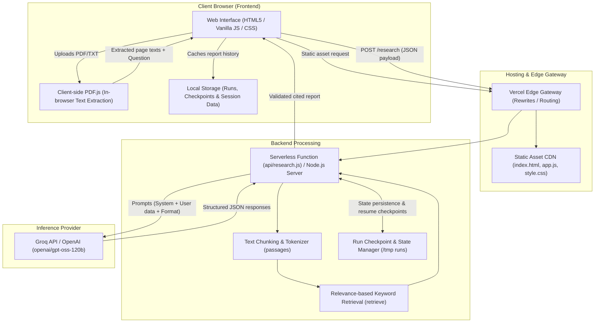
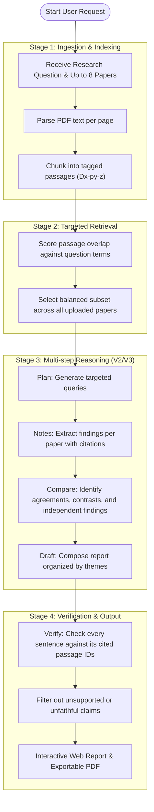
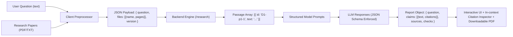

# ResearchPilot — System Architecture & Workflow Diagrams

This document contains the core diagrams for **ResearchPilot** as required by Milestone 2 guidelines:
1. **System Architecture Diagram** (App & Deployment flow)
2. **RAG Pipeline & Prompt Workflow Diagram** (Retrieval & Multi-stage model execution)
3. **Task Decomposition Diagram** (Modular stages of research generation)
4. **Input–Output Flow Diagram** (Data transformation pipeline)

---

## 1. System Architecture Diagram

---

## 2. RAG Pipeline & Prompt Workflow Diagram

```mermaid
flowchart LR
    subgraph Ingestion ["1. Document Ingestion"]
        DOCS["1–8 Research Papers (PDF/TXT)"] --> EXTRACT["Extract Page Texts"]
        EXTRACT --> CHUNK["Sliding Window Chunking (180 tokens, step 150)"]
        CHUNK --> IDS["Attach Unique Passage IDs (e.g., D1-p2-3)"]
    end

    subgraph Retrieval ["2. Evidence Retrieval"]
        QUERY["Research Question"] --> RETRIEVE["Keyword & Overlap Scoring"]
        IDS --> RETRIEVE
        RETRIEVE --> SELECTION["Top Relevant Passages (Ranked per paper)"]
    end

    subgraph Execution ["3. Workflow Execution"]
        SELECTION --> ROUTER{"Workflow Version"}
        
        ROUTER -->|"V1 Baseline"| V1_STAGE["v1/baseline: Single-call Report Generation"]
        
        ROUTER -->|"V2 Structured"| V2_PLAN["v2/plan: Sub-query Planning"]
        V2_PLAN --> V2_NOTES["v2/notes: Per-paper Evidence Extraction"]
        V2_NOTES --> V2_COMPARE["v2/compare: Cross-paper Comparison"]
        V2_COMPARE --> V2_REPORT["v2/report: Structured Synthesis"]

        ROUTER -->|"V3 Citation Review"| V2_REPORT
        V2_REPORT --> V3_VERIFY["v3/verify: Automated Claim Verification"]
        V3_VERIFY -->|"Evidence Check"| CHECK{"Passages support claims?"}
        CHECK -->|"Supported"| FINAL["Final Verified Report"]
        CHECK -->|"Unsupported & more passages available"| RETRY["Fetch secondary passages & re-verify"]
        RETRY --> V3_VERIFY
    end
```

---

## 3. Task Decomposition Flow

---

## 4. Input–Output Flow Diagram

